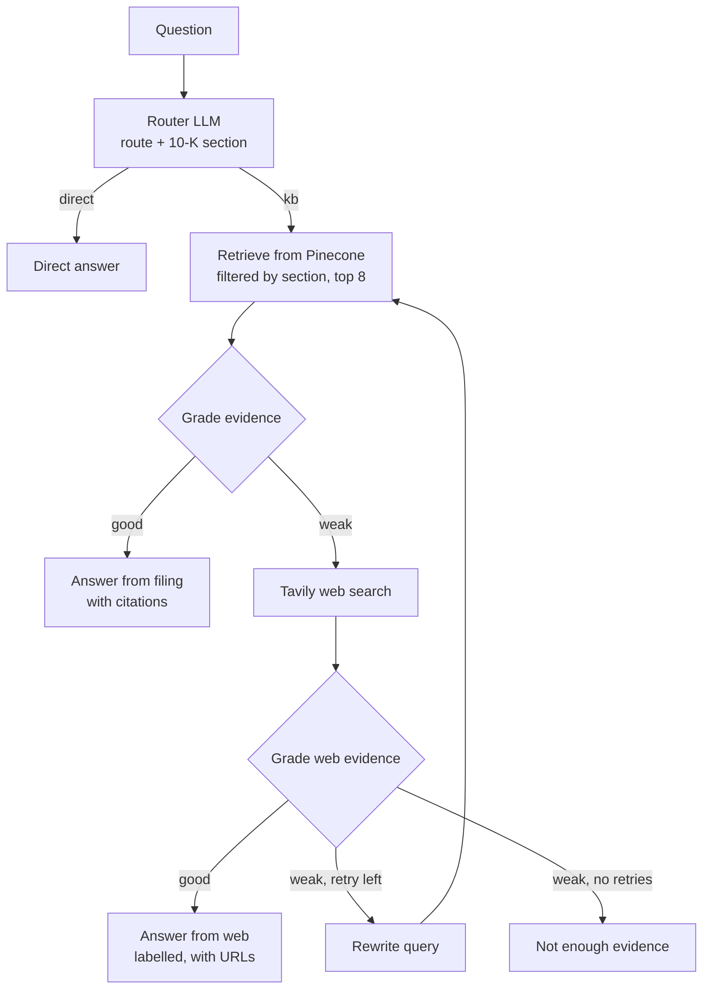

# 📈 SEC Filings Equity Research Assistant (Agentic RAG)


## 📌 Project Overview
An agentic RAG assistant that answers questions about a company from its latest **SEC 10-K filing**. It loads the filing straight from SEC EDGAR, routes each question to the right 10-K section, checks whether the retrieved evidence is good enough, and answers with **section-level citations**. If the filing can't answer, it falls back to a labelled web search.

The filing is the source of truth: the assistant is told to use only the excerpts, say what is missing, and never give buy/sell/hold advice.

## ⚙️ Tech Stack

**Orchestration:** LangGraph · LangChain

**LLM:** Groq (`openai/gpt-oss-20b`)

**Retrieval:** Pinecone · `BAAI/bge-base-en-v1.5` embeddings (768-d, cosine)

**Data:** SEC EDGAR via `edgartools` (10-K text sections + XBRL financial statements)

**Web fallback:** Tavily

## 🏗 Architecture



### 1. 📥 Ingestion (`app/ingest.py`)
- Loads the latest original 10-K (amendments skipped) for the configured ticker from SEC EDGAR.
- Text sections: **Items 1, 1A, 1C, 2, 3, 5, 7 and 7A**, each tagged with ticker, section, filing date and accession number.
- Text is split with `RecursiveCharacterTextSplitter` (1000 characters, up to 200 overlap).
- **Item 8 financial statements** (income statement, balance sheet, cash flow) come from **XBRL** and are stored **whole, one chunk per table**, so rows never get separated from their year headers. Each table gets a short LLM-written description in front to help search.
- Chunks get stable IDs, so re-running ingest overwrites instead of duplicating.

### 2. 🧭 Routing by section (`app/agent.py`)
The router LLM picks both the route (`kb` or `direct`) and the **10-K section** to search, e.g. legal questions → Item 3, exact figures → Item 8. Retrieval is then filtered to that section before the cosine search.

This fixed a real retrieval problem: for *"What legal proceedings is Apple involved in?"*, an unfiltered top-8 search returned only **1 of the 8** Item 3 chunks, because the much larger risk factors section crowded them out. With the section filter, it returns **all 8**.

### 3. ✅ Evidence grading and fallback
An LLM grader checks whether the excerpts actually answer the question. Weak evidence goes to Tavily web search, which is graded too, with one query rewrite before the agent says it doesn't have enough evidence.

## 🎖️ Results

Baseline on a small hand-written eval set (`evals/eval_set.json`, 10 questions: 8 about the filing, 2 small-talk), run with `python -m app.evals`. This run was before Item 8 tables were added.

| Metric | Score |
| --- | --- |
| Routing (kb vs direct) | 10/10 |
| Correct section retrieved | 7/8 |
| Answer contains expected keywords | 7/8 |

Both misses came from the eval set rather than the pipeline: one question fits two sections, and one keyword ("iCloud") doesn't appear in the filing, which says "cloud services".

## ⚠️ Known Limitations
- **Calculations are done by the LLM.** It reads the right numbers but can use the wrong method, e.g. comparing dollar increases instead of percentage growth.
- **One section per question**, so questions needing both reasons (Item 7) and figures (Item 8) aren't combined yet.
- **One company at a time** (set by `TICKER`).
- Small eval set with keyword checks only.
- Some tables inside Items 5–7 can be split across chunks.

## 🛣️ Roadmap
- [ ] Python tools for growth, margins and ratios from XBRL
- [ ] Multi-section retrieval for "why + how much" questions
- [ ] Multiple companies and comparison questions
- [ ] Larger eval set with exact-number and trap questions
- [ ] Simple UI with clickable sources

## 🛠 Setup & Installation

### 1. Clone and install

```bash
git clone https://github.com/Minex101/RAG_Project.git
cd RAG_Project
python -m venv .venv
.venv\Scripts\Activate.ps1      # Windows (macOS/Linux: source .venv/bin/activate)
pip install -r requirements.txt
```

### 2. Add your keys
Create a `.env` file (see `.env.example`):

```
GROQ_API_KEY=
PINECONE_API_KEY=
TAVILY_API_KEY=
EDGAR_IDENTITY=Your Name your@email.com
```

The SEC asks every EDGAR client to identify itself, which is what `EDGAR_IDENTITY` is for.

### 3. Run
Change `TICKER` (and `NAMESPACE`) in `app/config.py` if you want another company.

```bash
python -m app.ingest   # load the 10-K into Pinecone
python -m app.agent    # ask questions in the terminal
python -m app.evals    # run the eval set
```
